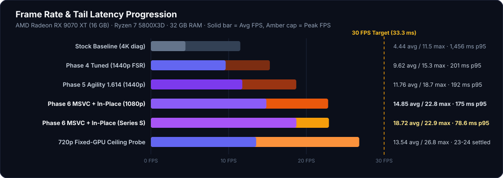
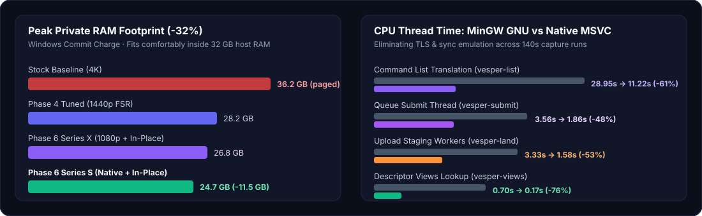

<picture>
  <source media="(prefers-color-scheme: dark)" srcset="docs/media/hero-dark.svg">
  <source media="(prefers-color-scheme: light)" srcset="docs/media/hero-light.svg">
  
</picture>

# Vesper

     

**Vesper** is a high-performance Windows x64 compatibility and DirectX 12 renderer-porting layer for Xbox Series ("Scarlett") executables, built in Rust. Rather than relying strictly on brute-force shared-memory emulation every frame, Vesper patches console rendering paths toward native PC GPU execution while translating shaders offline ahead of time.

> [!IMPORTANT]
> **Bring Your Own Lawful Dump.** Vesper contains **no game files, no proprietary executables, no decrypted assets, no keys, and no download links**. Everything runs locally against binaries supplied by the user under strict static verification (`cargo test -p xtask`). Requests for game files, keys, dumps, or unauthorized downloads are closed immediately. See [Asset Policy](docs/asset-policy.md).

---

## Upstream Attribution & Lineage

Vesper is free software licensed under the **GNU General Public License v3.0 or later** ([`LICENSE`](LICENSE)):
- Built upon the open-source **[VIctory](https://github.com/Marvisak/VIctory)** compatibility runtime and its **AMD RDNA 4 / 32 GB RAM community fork** engineering (`VIctory-Belobug-AMD`).
- Architectural direction for in-place GPU memory and renderer porting is also informed by research in **[XCL](https://github.com/xcl-dev/xcl)**.

---

## Highlights & Engineering Wins

- **Native MSVC Pipeline (`-61%` CPU command-list overhead):** Building `vesper.exe` natively on `x86_64-pc-windows-msvc` (`-C target-cpu=native`) eliminated MinGW/GNU TLS and synchronization stalls, cutting `vesper-list` CPU time from `28.95s` to `11.22s` (**-61%**) and `vesper-views` by **-76%**.
- **D3D12 Agility SDK `1.614.1` Scoped Enhanced Barriers:** Exports `D3D12SDKVersion=614` (`D3D12Core.dll`) for native Windows 11 enhanced barriers, caches `ID3D12GraphicsCommandList7` on command recorders, coalesces consecutive global and indirect pre-clamp barriers (`~119–122` barriers merged per frame), and enables `ALLOW_TEARING` borderless presentation.
- **In-Place Hot Memory (`VESPER_INPLACE_HOT=1`):** Maps `20–32` active graphics regions (`301–401 MB`) directly in place without host bounce copies or upload/readback loops, cutting card host copies (`116 / 749 MB` → `86–96 / 489–585 MB`) and slashing 1080p frame-time `p95` from `386.5 ms` down to `174.6 ms`.
- **32 GB Host Friendly (`36.2 GB → 24.7 GB` Private Commit):** Reduced peak private RAM by **11.5 GB (-32%)** through readback/upload pool bounds, unmapped placed-texture sweeps, VRAM residency hysteresis, and `2048 px` default mip ceilings.
- **RDNA 4 Native Shader Pipeline & Optional DXR:** Translates all `25,790` shaders ahead of time into a disk cache (`native f16` wave64 arithmetic on RDNA 4), fixes PC FidelityFX FSR 4.1.2 integration (`VESPER_FSR_4K`), calibrates interior ambient lighting, and supports experimental RDNA 4 hardware BVH4 ray tracing (`VESPER_HW_BVH=1`).

---

## Subsystem Status

| Subsystem | Crates | Status | Scope |
|---|---|---|---|
| PE32+ Loader & Imports | `vesper-pe`, `vesper-loader` | Working | Maps x64 images, resolves `imports`, and redirects static `TLS` slots |
| Console HLE & Input | `vesper-hle` | Working | Implements `xgameruntime` and core console APIs; optional `VESPER_KBM_PC` |
| D3D12 Translation & Barriers | `vesper-gpu` | Working | Agility `1.614.1` command list recording, descriptor porting, smart barriers |
| Shader Pipeline & DXR | `vesper-shader`, `vesper-pipeline` | Working | SSA IR structurization and offline disk cache; HW BVH4 RT experimental |
| Formats & Asset Codecs | `vesper-formats` | Working | `BCPack` stream decoding, GPU texture `tiling` / detiling, audio codecs |
| Telemetry HUD & Control Menu | `vesper-gpu` (`host/panel`) | Working | `F3` Basic/Advanced frame-time HUD and `~` live-tuning overlay (`VESPER_PANEL`) |

---

## Benchmarks & Progression

All measurements below were captured on a **Windows 11 Pro** system running an **AMD Ryzen 7 5800X3D** (8C/16T, **32 GB DDR4**) and **AMD Radeon RX 9070 XT (16 GB VRAM)** across heavy opening gameplay sequences (ray tracing off unless noted):

<picture>
  <source media="(prefers-color-scheme: dark)" srcset="docs/media/perf-progression-dark.svg">
  <source media="(prefers-color-scheme: light)" srcset="docs/media/perf-progression-light.svg">
  
</picture>

<picture>
  <source media="(prefers-color-scheme: dark)" srcset="docs/media/cpu-ram-dark.svg">
  <source media="(prefers-color-scheme: light)" srcset="docs/media/cpu-ram-light.svg">
  
</picture>

| Configuration / Preset | Avg FPS | Med FPS | Max FPS | Tail FPS | Med / p95 ms | GPU Busy | Peak Priv RAM | VRAM (Local / Shared) |
|---|---:|---:|---:|---:|---:|---:|---:|---|
| Stock Baseline (4K `diag`) | 4.44 | 4.60 | 11.5 | — | 218.5 / 1,456.1 | — | 36,193 MB | 13.6 / 14.0 GB |
| Phase 4 Tuned (1440p FSR Quality) | 9.62 | 9.00 | 15.3 | — | 111.2 / 201.0 | 39.3% | 28,234 MB | 10.4 / 7.9 GB |
| Phase 5 Agility 1.614 (1440p NO-FSR GNU) | 11.76 | 10.40 | 18.7 | 17.6–18.7 | 96.2 / 191.9 | 56.3% | 27,642 MB | 10.4 / 7.4 GB |
| **Phase 6 Series X 1080p NO-FSR (`INPLACE_HOT`)** | **14.85** | **15.20** | **22.8** | **22.2–22.8** | **66.1 / 174.6** | **70.25%** | **26,753 MB** | **10.4 / 8.0 GB** |
| **Phase 6 Series X 1440p NO-FSR (`INPLACE_HOT`)** | **13.04** | **12.40** | **20.9** | **20.7–20.9** | **80.7 / 182.0** | **70.21%** | **27,090 MB** | **10.4 / 7.4 GB** |
| **Phase 6 Series S Native (`INPLACE_HOT`)** | **18.72** | **19.60** | **22.9** | **20.4–21.3** | **50.9 / 78.6** | **77.89%** | **24,659 MB** | **10.4 / 7.5 GB** |
| Phase 6 Series X 1080p FSR 4.1.2 Quality | 10.65 | 8.85 | 21.6 | 13.4–21.6 | 112.7 / 343.3 | 51.67% | 26,189 MB | 10.3 / 8.1 GB |
| Phase 6 720p Ceiling Probe (Fixed-GPU check) | 13.54 | 11.60 | **26.8** | 22.9–24.0 | 86.6 / 509.2 | 54.82% | 26,486 MB | 10.4 / 7.2 GB |

### Where the Remaining 30 FPS Frame Time Goes

Hardware GPU timestamp profiling (`VESPER_GPU_TIMING=1`) shows why `720p`, `1080p`, and `1440p` cluster around a ~21–24 FPS settled plateau (`~44–48 ms/frame`):
- Mean GPU work in instrumented runs is **`79.18 ms`** spread across **`266` command lists/frame** (`193` title lists, `59` copy preludes, `14` card compares) — minimum per-list execution/sync floor alone adds **`~13 ms/frame`**.
- **`~1,082` indirect draw/dispatch argument clamps per frame** force intra-frame UAV barriers (`~1,600` enhanced barrier groups even after coalescing). *Note: disabling clamping cleanly breaks character shading, so removing it safely requires batching or GPU-side indirect validation without extra sync splits.*
- With DXGI borderless tearing active (`VESPER_BORDERLESS=1` + `ALLOW_TEARING`), enabling **AMD AFMF 2** (or Lossless Scaling 2x) on **1080p Series X** or **Series S Native** turns that ~20–23 FPS base into **~40–46 FPS** smooth output without spatial upscaling shimmer.

---

## Build & Quick Start

### Prerequisites
- **Windows 10/11 x64**, AVX2 CPU, DirectX 12 GPU (Shader Model 6.6 + Mesh Shaders; 16 GB+ VRAM and 32 GB+ RAM recommended).
- **Rust MSVC toolchain** (`1.98.1-x86_64-pc-windows-msvc` + Visual Studio C++ Build Tools).
- **DirectX 12 Agility SDK `1.614.1`** (`D3D12Core.dll` placed under `target\release\D3D12\` next to `vesper.exe` for native Enhanced Barriers support on Windows 11 22H2+).
- Your own legally obtained Xbox Series title files configured **outside** this repository.

### Build Native MSVC Binary

```powershell
$env:RUSTFLAGS = "-C target-cpu=native"
cargo +1.98.1-x86_64-pc-windows-msvc build --release --locked --bin vesper
```

Copy `vesper.example.toml` to `vesper.toml` (git-ignored) and set paths outside the repo:

```powershell
copy vesper.example.toml vesper.toml
# Or use the interactive multi-preset Windows launcher:
scripts\launch.cmd "D:\path\to\your\title.exe"
```

---

## Configuration Switches

| Switch | Default / Value | Purpose |
|---|---|---|
| `VESPER_INPLACE_HOT` / `VESPER_INPLACE_HOT_MB` | `1` / `512` | Keep hot title graphics memory regions in place (avoids host bounce copies & cuts `p95` spikes) |
| `VESPER_PORT_CONSTANTS` / `VESPER_PORT_CBV` | `1` / `1` | Let shaders read console constant heaps directly as raw buffers (`0` constant fills) |
| `VESPER_PORT_DESCRIPTORS` / `VESPER_PORT_GUARD` / `VESPER_PORT_JOURNAL` | `1` / `1` / `1` | Patched descriptor slot tracking, block-level write guards, and partitioned submission journals |
| `VESPER_WAIT_RESIDENT` | `textures` | Wait for streamed textures before use (**required** to avoid texture/face corruption) |
| `VESPER_PARALLEL_LISTS` / `VESPER_LIST_THREADS` | `1` / `8` | Parallel command-list translation worker pool |
| `VESPER_COALESCE_BARRIERS` / `VESPER_SMART_BARRIERS` / `VESPER_MERGE_LISTS` | `0` (`1` in launcher) / `1` / `96` | Coalesce adjacent D3D12 barriers, summarize enhanced barrier hazards, and merge small command lists |
| `VESPER_RESIDENCY` / `VESPER_PRESSURE_PHYSICAL` / `VESPER_PRESSURE_FREE_MB` | `0` / `0` / `1536` (`1` / `1` / `2560` in launcher) | Host RAM residency admission, physical-memory pressure floor, and idle upload trimming |
| `VESPER_TEXTURE_STAGE_MS` / `VESPER_TEXTURE_STAGE_MB` / `VESPER_TEXTURE_CATCHUP` | `250` / `0` / `1` (`35` / `96` / `0` in launcher) | Anti-stutter texture staging pacing budget and backlog burst control |
| `VESPER_WINDOW_BUDGET_MB` / `VESPER_DEFER_FREE_FRAMES` | `unset` / `16–64` (`1024` / `8` in launcher) | Loose title-window copy byte budget and deferred retired resource/list cleanup lag |
| `VESPER_OUTPUT` / `VESPER_BORDERLESS` / `VESPER_TEARING` | `1920x1080` / `1` / `1` | Override Series X render/output size (`unset` on Series S); borderless window with `ALLOW_TEARING` |
| `VESPER_FSR_4K` / `VESPER_PC_FSR` | `quality` / `1` | Optional FidelityFX SDK 2.4 (`amd_fidelityfx_upscaler_dx12.dll`) upscaling |
| `VESPER_HW_BVH` / `VESPER_BVH_BUILDER` | `0` / `0` | Experimental DXR / RDNA 4 hardware BVH4 indirect lighting |
| `VESPER_PANEL` | `0` (`1` in launcher) | Interactive telemetry HUD (`F3`: Basic / Advanced / Off) and `~` live Control Center menu |
| `VESPER_KBM_PC` | `0` | Optional PC keyboard & mouse mapping (`~`/`F2` mouse look lock, `VESPER_MOUSE_SENS`, `VESPER_MOUSE_INVERT_Y`) |

See [`docs/architecture.md`](docs/architecture.md) and [`docs/fork-ray-tracing.md`](docs/fork-ray-tracing.md) for deep architectural notes.

---

## Contributing & Claimable Roadmap (`VSP-01` – `VSP-16`)

Both human engineers and AI-assisted contributors are welcome — **with strict claim discipline and peer verification built into the repository**:

- **AI Agents Auto-Governed:** [`AGENTS.md`](AGENTS.md), [`CLAUDE.md`](CLAUDE.md), [`.cursor/rules/vesper.mdc`](.cursor/rules/vesper.mdc), and [`.github/copilot-instructions.md`](.github/copilot-instructions.md) automatically enforce claim checks, file scope locks, safety barriers, and clean-room rules.
- **Claim First:** Pick an **Open** task (`VSP-01` – `VSP-16`) from **[`ROADMAP.md`](ROADMAP.md)** and open a **`Task Claim` issue** before coding.
- **3-Independent-Review Gate:** Every PR must pass CI, automated `pr-intake`, and earn **3 independent `APPROVED` peer reviews** (using the audit rubric in **[`CONTRIBUTING.md`](CONTRIBUTING.md)**) before maintainer review.
